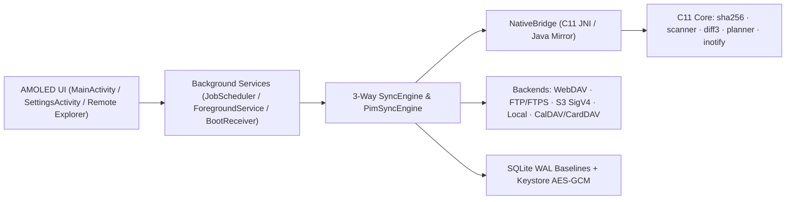

# Synk

A minimal, true-AMOLED (`#000000`) Android file, calendar, and contacts synchronization app written in **C11 + pure Java** with **zero external library dependencies** (~132 KB signed APK, compiles in ~3 seconds without Gradle).

## Highlights

- **Ultra-Small & Dependency-Free**: Pure Android Framework UI + pure Java protocol/sync engine + C11 native JNI core (`0` Maven/AndroidX/Kotlin/OkHttp dependencies).
- **Custom 3-Way Sync Engine & Diff3 Merge**:
  - Stateful SQLite WAL baseline (`size`, `mtime`, SHA-256, remote `ETag`, plus lightweight text base snapshots) so offline edits, renames, touches, and modify-vs-delete conflicts are handled cleanly without data loss.
  - Native C11 LCS **3-way `diff3` auto-merge** cleanly merges non-overlapping text edits on both client and server; overlapping hunks and binary conflicts queue into the interactive **Conflict Manager** with an editable diff preview.
- **Native C11 Core (`native/`) with Automatic Fallback**:
  - Streaming RFC 6234 SHA-256 (`sha256.c`), POSIX recursive scanner + glob ignore matcher (`scanner.c`), 3-way `diff3` (`diff3.c`), topologically ordered 3-way planner (`planner.c`), and recursive Linux `inotify` watcher (`watcher.c`).
  - Transparent pure-Java algorithmic mirror (`PureJavaFallback.java`) runs automatically if built without Android NDK.
- **Multiple Protocols & Cloud Providers**:
  - **WebDAV** — Nextcloud, OwnCloud, Seafile (`/seafdav`), SabreDAV, Apache/Nginx WebDAV (Basic & Bearer auth, optional self-signed TLS trust).
  - **FTP / FTPS** — RFC 959 + RFC 4217 Explicit TLS (`AUTH TLS`, `PBSZ 0`, `PROT P`, `PASV`, `MLSD` + Unix `LIST` fallback).
  - **S3-Compatible Object Storage** — AWS S3, Backblaze B2, Cloudflare R2, MinIO, Wasabi via native AWS Signature Version 4 (`HMAC-SHA256`).
  - **Local / Mounted Folders** — SD cards, USB OTG, or local FUSE/SMB mounts.
- **Built-In Remote & Local File Explorers**:
  - Browse remote folders directly over WebDAV, FTP/FTPS, S3 (`delimiter=/`), or Local targets — navigate up/down, inspect existing files and sizes, create remote directories, and select your exact sync target.
- **Live Sync Telemetry & Cancellation**:
  - Real-time AMOLED progress panel & live notification bar showing current phase, active filename, per-file & batch byte progress, rolling EWMA transfer speed (`KB/s` / `MB/s`), live ETA, live `↑ / ↓ / ⇄ / ✕ / ⚠` counters, and one-tap **Cancel**.
- **Fine-Grained AMOLED Settings Page**:
  - Engine selector (Native C11 vs Java fallback), concurrent job count, I/O buffer size, bandwidth throttle limit (`KB/s`), max single file size, preserve timestamps, paranoid SHA-256 re-hash mode, `inotify` debounce delay, self-sync cooldown, battery level & Battery Saver pause policy, connect/read timeouts, exponential backoff retries, default sync/conflict modes, max auto-merge size, custom device tag, global ignore rules, notifications, log retention, and baseline maintenance.
- **CalDAV & CardDAV (Calendar & Contacts)**:
  - Bidirectional RFC 4791 **CalDAV** (`.ics` ↔ Android `CalendarContract`) and RFC 6352 **CardDAV** (`.vcf` ↔ Android `ContactsContract`) sync with ETag change tracking and conflict handling.
- **Encrypted Credentials**:
  - Stored server passwords/tokens are encrypted at rest with Android Keystore **AES-256-GCM**.

## Architecture



## Sync Modes & Conflict Policies

| Sync Mode | Behavior |
|---|---|
| `Two-Way Sync` | Full 3-way bidirectional sync with diff3 auto-merge and conflict detection |
| `Upload Only` | Pushes local additions & edits; ignores remote-only files |
| `Upload Mirror` | Makes remote an exact mirror of local (deletes remote extras) |
| `Download Only` | Pulls remote additions & edits without modifying remote |
| `Download Mirror` | Makes local an exact mirror of remote (deletes local extras) |
| `Backup (No Delete)` | Appends/updates local files on remote; never deletes anything on either side |

| Conflict Policy | Behavior |
|---|---|
| `Auto-Merge Text, Else Ask` | Runs C11 3-way `diff3`; clean merges sync automatically, overlaps/binaries open in Conflict Manager |
| `Ask (Conflict Manager)` | Preserves both versions and queues in the Conflicts tab with editable diff preview |
| `Keep Both Copies` | Saves local copy as `<name>.conflict-<device>-<timestamp>.<ext>` and pulls remote |
| `Local Always Wins` | Overwrites remote with local version |
| `Remote Always Wins` | Overwrites local with remote version |
| `Newest Timestamp Wins` | Keeps newer modification timestamp |

## Server URL Examples

| Service | Protocol | Example URL |
|---|---|---|
| **Nextcloud Files** | WebDAV | `https://cloud.example.com/remote.php/dav/files/<username>` |
| **Seafile** | WebDAV | `https://seafile.example.com/seafdav` |
| **FTP / FTPS** | FTP / FTPS | `ftp://192.168.1.10:21/backup` or `ftps://nas.example.com:21` |
| **AWS S3 / B2 / R2 / MinIO** | S3 | Endpoint `https://s3.us-east-1.amazonaws.com`, Extra `my-bucket\|us-east-1` |
| **Nextcloud Calendar** | CalDAV | `https://cloud.example.com/remote.php/dav/calendars/<user>/personal/` |
| **Nextcloud Contacts** | CardDAV | `https://cloud.example.com/remote.php/dav/addressbooks/users/<user>/contacts/` |

## Build & Test

### 1. Run Full Test Suite (C11 ASan/UBSan + JNI + End-to-End Integration Tests)
```bash
./test.sh
```
Tests run against real embedded loopback WebDAV, CalDAV, CardDAV, S3, and FTP servers plus real Linux `inotify` kernel events.

### 2. Build Signed Android APK (No Gradle Required)
Requires JDK 17+ (`javac`, `keytool`), Python 3, and Android SDK (`platforms/android-*`, `build-tools/*`):
```bash
./build.sh
# Output: build/synk.apk
```

To bundle the cross-compiled C11 JNI shared libraries (`arm64-v8a`, `armeabi-v7a`, `x86_64`), install the Android NDK and re-run `./build.sh`:
```bash
sdkmanager "ndk;27.2.12479018"
./build.sh
```

### 3. Install on Device
```bash
adb install -r build/synk.apk
```

## F-Droid & Reproducible Builds

Synk complies with the [F-Droid Inclusion Policy](https://f-droid.org/en/docs/Inclusion_Policy/) (100% MIT FOSS, zero proprietary SDKs, zero trackers, zero prebuilt blobs) and includes:

- **Fastlane Store Metadata**: `fastlane/metadata/android/en-US/` (`title.txt`, `short_description.txt`, `full_description.txt`, `changelogs/`, `images/icon.png`, `images/featureGraphic.png`)
- **F-Droid Recipe**: [`fdroid/org.synk.yml`](fdroid/org.synk.yml) and step-by-step submission guide [`fdroid/README.md`](fdroid/README.md)
- **Automated Policy & Metadata Linter**: `./scripts/fdroid-check.sh`
- **Bit-for-Bit Reproducible Unsigned Builds**: `./build.sh --unsigned` normalizes compiler paths, ELF build IDs, ZIP ordering, and `SOURCE_DATE_EPOCH` timestamps.

## CI/CD & Auto-Release on `main` Tags

- **CI (`.github/workflows/ci.yml`)**: Runs on every push/PR to `main` — executes `./scripts/fdroid-check.sh`, `./test.sh` (C11 ASan/UBSan + JNI + 10 integration tests), verifies bit-for-bit reproducible unsigned APK builds across two passes, and uploads native NDK APK artifacts.
- **Auto-Release CD (`.github/workflows/release.yml`)**: Runs whenever a SemVer tag (`vX.Y.Z`) is pushed — verifies the tagged commit is on `main` and matches `version.properties`/`AndroidManifest.xml`, runs all checks + reproducibility verification, signs with your repository keystore secrets (`SIGNING_KEYSTORE_B64`, `SIGNING_KEYSTORE_PASSWORD`, `SIGNING_KEY_ALIAS`, `SIGNING_KEY_PASSWORD`), and publishes a GitHub Release with `synk-vX.Y.Z.apk`, `synk-vX.Y.Z-unsigned.apk`, `SHA256SUMS.txt`, and Fastlane changelog notes.

### Cutting a New Release
```bash
./scripts/bump-version.sh 1.1.0
# Edit fastlane/metadata/android/en-US/changelogs/2.txt
git add -A && git commit -m "Release v1.1.0"
git tag -a v1.1.0 -m "Synk v1.1.0"
git push origin main v1.1.0
```

## Pushing & Triggering First Release

```bash
git push origin main
git tag -a v1.0.0 -m "Synk v1.0.0"
git push origin v1.0.0
```

## License

[MIT](LICENSE)
